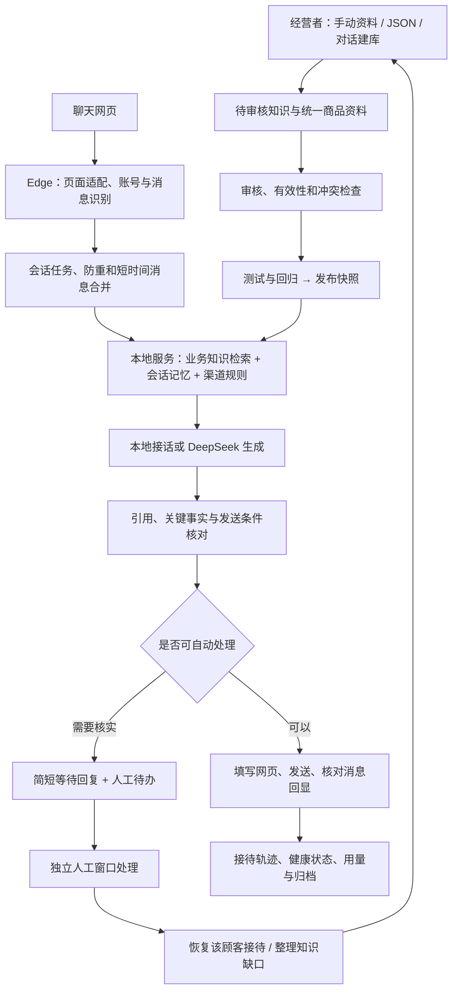

# 知答 · 网页智能客服工作台

**Answer Studio：把经营者确认的业务知识，变成可检索、可核对、可持续维护的客服回复。**

本项目由本地工作台、Node.js 服务、SQLite 数据库和 Edge 扩展组成。你可以为服装、文具、网站服务等业务分别建立知识库，通过手动录入或 AI 对话整理资料，审核并发布后，在已适配的聊天网页上自动识别咨询、生成回答、发送并核对结果。无法自动处理的问题进入人工待办，其他顾客继续接待。

项目采用“**通用客服核心 + 网页适配器 + 独立渠道规则**”的结构。小红书是内置网页适配之一；更换平台不应重写整套问答系统，但需要针对真实页面制作并验证适配。

> 当前源码版本：**服务 0.14.0 / Edge 扩展 0.11.0**。本文按 2026-10-23 的源码整理。
>
> 这里的“训练”指补充知识、调整规则和回归验证，**不修改 DeepSeek 的模型权重**。“发布”指启用知识快照，不代表已经部署到平台或启动自动发送。

## 目录

- [1. 项目定位与能力边界](#1-项目定位与能力边界)
- [2. 整体架构与工作流程](#2-整体架构与工作流程)
- [3. 环境要求与快速启动](#3-环境要求与快速启动)
- [4. 配置项与三种凭证](#4-配置项与三种凭证)
- [5. 工作台入口与第一次使用](#5-工作台入口与第一次使用)
- [6. 知识录入、对话建库与持续维护](#6-知识录入对话建库与持续维护)
- [7. 回答如何生成与核对](#7-回答如何生成与核对)
- [8. Edge 扩展安装与自动接待](#8-edge-扩展安装与自动接待)
- [9. 用本地演示验收完整流程](#9-用本地演示验收完整流程)
- [10. 按渠道配置回复规则](#10-按渠道配置回复规则)
- [11. 接入其他聊天网页](#11-接入其他聊天网页)
- [12. 人工接管、恢复与接待记录](#12-人工接管恢复与接待记录)
- [13. 发布、回归检查与版本回退](#13-发布回归检查与版本回退)
- [14. 数据位置、归档、备份与恢复](#14-数据位置归档备份与恢复)
- [15. 自动测试与验收依据](#15-自动测试与验收依据)
- [16. GitHub 公开数据的用途](#16-github-公开数据的用途)
- [17. 部署、运行与升级](#17-部署运行与升级)
- [18. 源码目录与主要模块](#18-源码目录与主要模块)
- [19. 常见问题与排查](#19-常见问题与排查)
- [20. 后续扩展与文档索引](#20-后续扩展与文档索引)

## 1. 项目定位与能力边界

### 适合解决的问题

- 一个经营者管理多个业务，例如分别维护“服装客服”“文具客服”“网站客服”。
- 根据已确认的商品规格、价格条件、发货和售后规则回答咨询。
- 通过对话逐步补齐业务知识，避免每条问答都从空白表单开始填写。
- 在已经适配的网页上连续处理文字私信，减少反复复制问题、粘贴回复的操作。
- 对超出资料或权限范围的问题提醒人工，并在处理后恢复该顾客的自动接待。
- 从真实漏答问题建立回归题，检查修改知识或提示词后是否出现退步。

### 当前能力

| 领域 | 已实现 | 使用边界 |
| --- | --- | --- |
| 业务管理 | 独立业务空间、业务规则、独立知识和测试会话 | 同一管理员管理，不是多租户权限系统 |
| 知识维护 | 手动录入、JSON 导入导出、修正、审核、引用、有效期和紧急停用 | 导入和 AI 整理结果仍需经营者核实 |
| 对话建库 | 主动追问、主题进度、原话来源、缺口整理、待审核入库 | 不自动确认未知事实，不自动发布 |
| 商品资料 | 统一规格、价格与单位、服务政策，问答引用共同资料 | 不是实时商品、库存或订单系统 |
| 问答 | 正文与别名检索、多轮上下文、多问题拆分处理、简短自然回复 | 当前不是向量检索，也不能保证所有换种说法都能召回 |
| 回答核对 | 来源校验、关键事实与条件检查、发送前知识和渠道状态复核 | 规则检查不能证明任意自然语言回答完全正确 |
| 网页接待 | 小红书内置适配、可导入 DOM 适配、本地聊天演示 | 淘宝、千牛等真实页面尚需单独适配和验收 |
| 自动执行 | 检测、生成草稿、单条发送验证、连续接待、防重、结果不明时停发 | 依赖浏览器、登录状态和页面结构 |
| 人工协作 | 待办提醒、独立人工窗口、单顾客接管与恢复 | 关闭人工窗口不等于业务问题已经解决 |
| 运行维护 | 心跳、积压与异常提示、接待轨迹、Token 用量、归档、备份恢复 | 不等于已经验证长期无人值守或商业级可用性 |
| 质量验证 | 发布回归、知识缺口复测、自动测试、浏览器模拟验收 | 模拟通过不代表真实平台或真实业务准确率 |

当前没有实现实时订单/物流/库存查询、退款执行、支付核验、图片 OCR、语音识别、桌面视觉控制、PDF/Word/Excel 自动解析、模型微调、完整多人角色权限或平台官方消息接口。

### 四个容易混淆的概念

| 概念 | 决定什么 | 示例 |
| --- | --- | --- |
| 业务空间 | 客服知道哪些商品、事实和业务规则 | 文具客服、服装客服 |
| 网页适配 | 如何识别这个网页的账号、会话、消息和发送入口 | `xiaohongshu`、`web-demo` |
| 渠道规则 | 在这个渠道允许怎样表达、提供链接、处理历史咨询 | 某平台的推广要求、消息时限 |
| 发布版本 | 正式接待使用哪一份已审核业务知识和规则快照 | v1、v2 |

同一业务可以复用到多个渠道；渠道规则不应混进所有业务共用的商品事实。不同顾客的处理状态也不应因共用知识而混用。

## 2. 整体架构与工作流程

### 技术组成

| 部分 | 技术 |
| --- | --- |
| 本地服务 | Node.js 24+、ES Modules、原生 HTTP |
| 数据库 | Node 内置 `node:sqlite`，SQLite WAL |
| 管理工作台 | 原生 HTML / CSS / JavaScript |
| 浏览器扩展 | Manifest V3、Edge/Chromium 扩展 API |
| 模型接入 | 服务端调用 DeepSeek Chat Completions |
| 检索 | 本地文本片段加权匹配、别名与型号约束 |
| 测试 | Node 内置测试运行器、隔离的 Edge 浏览器模拟 |

没有第三方 Node 运行依赖，不需要前端构建，也不需要单独安装数据库或向量服务。

### 数据流



API 密钥只保存在服务端。扩展通过本地连接令牌访问服务，不直接持有 DeepSeek 密钥。正常问答和建库会把必要的资料与对话内容发送给所配置的模型服务，因此只应录入接待所需的信息。

## 3. 环境要求与快速启动

### 环境要求

- **Node.js 24 或以上**；项目使用内置 SQLite 和环境文件加载功能。
- Windows + Microsoft Edge 是当前主要开发和浏览器验收环境。
- 调用模型时需要能访问 DeepSeek API；仅做精确标准问答可不配置模型。
- 下载公开数据时使用网络和 `tar`；日常客服不需要下载公开数据。

先在 PowerShell 检查：

```powershell
node --version
npm.cmd --version
```

### 第一次启动

在项目目录打开 PowerShell：

```powershell
Set-Location 'C:/你的项目目录/answer-studio'

# 已有 .env 时保留现有配置，避免覆盖密钥。
if (!(Test-Path -LiteralPath .env)) {
    Copy-Item -LiteralPath .env.example -Destination .env
}
```

用编辑器打开 `.env`，填写自己的新密钥，再运行：

```powershell
./start.cmd
```

打开 [本地工作台](http://127.0.0.1:3080/)。

`start.cmd` 使用服务守护脚本：子服务异常退出后按 1 秒起、最长 30 秒间隔重启；遇到端口冲突或非本机监听缺少访问令牌等错误时停止重试。它只守护本地服务，不负责浏览器登录或平台验证。

开发时也可以直接运行：

```powershell
npm.cmd start
```

此命令直接启动服务，**不包含上述进程守护**。两种方式选择一种，不要同时启动两份服务。

### 常用本地地址

| 入口 | 地址 | 用途 |
| --- | --- | --- |
| 工作台 | [打开工作台](http://127.0.0.1:3080/) | 知识、测试、发布和运营维护 |
| 本地问答调试 | [打开调试页](http://127.0.0.1:3080/#debug) | 只测试回答，不读取或发送平台消息 |
| 服务状态 | [查看状态](http://127.0.0.1:3080/api/status) | 查看版本、模型配置标记 |
| 聊天演示 | [打开演示页](http://127.0.0.1:3080/web-chat-demo/chat/a) | 模拟网页收发与自动接待 |

状态中的 `configured: true` 只表示已填写 API 密钥，不代表已经验证密钥、余额、网络或模型名称可用。

停止服务前先暂停自动接待，再在启动服务的终端按 `Ctrl+C`。修改 `.env` 后需要重启服务。

## 4. 配置项与三种凭证

### 环境变量

基础配置见 [.env.example](.env.example)。

| 变量 | 默认值 | 说明 |
| --- | --- | --- |
| `DEEPSEEK_API_KEY` | 空 | 你自己的模型 API 密钥，仅服务端使用 |
| `DEEPSEEK_MODEL` | `deepseek-flash` | 代码默认值；必须填写自己 API 账户实际可用的模型名称 |
| `HOST` | `127.0.0.1` | 默认只监听本机 |
| `PORT` | `3080` | 工作台与 HTTP 服务端口 |
| `ADMIN_TOKEN` | 空 | 管理接口访问令牌；非回环地址监听时至少 24 个字符 |
| `DB_PATH` | `data/studio.sqlite` | 可选，自定义数据库文件；建议使用绝对路径并预先创建父目录 |
| `BACKUP_DIR` | 数据库同级的 `managed-backups/` | 可选，托管数据库备份目录 |
| `ARCHIVE_DIR` | 项目 `data/archives/` | 可选，接待记录归档目录 |

最后三个变量由服务支持，但没有预填在示例环境文件中。默认模型名称是程序配置，不能据此推断供应商当前提供哪些模型。模型 API 地址在源码中配置，当前没有环境变量形式的自定义 Base URL。

**修改端口时需要注意：**扩展后台的本地连接地址目前固定为 `http://127.0.0.1:3080/api/bridge/`，演示适配也使用 3080。只改 `PORT` 不会自动更新扩展；应同步修改并验证 [background.js](edge-extension/background.js) 和演示适配，或保持默认端口。

### 不要混用这三种凭证

| 凭证 | 从哪里配置或取得 | 填在哪里 |
| --- | --- | --- |
| DeepSeek API 密钥 | 自己的模型账户 | 服务端 `.env` |
| 本地连接令牌 | 首次启动生成的 `data/edge-bridge-token.txt` | Edge 扩展“连接设置” |
| 管理访问令牌 | 自己设置的 `ADMIN_TOKEN` | 工作台“设置管理访问令牌” |

不要把模型密钥填进网页适配文件、知识库或扩展连接令牌输入框。已经公开的密钥应更换，不要复用。不要把 `.env`、数据库、归档或浏览器登录资料上传到公开仓库。

## 5. 工作台入口与第一次使用

### 六个主要页面

| 入口 | 主要用途 |
| --- | --- |
| **01 知识与训练** | 对话建库、手动问答、统一商品资料、审核与有效性维护 |
| **02 问答实验室** | 草稿/发布模式测试、多轮追问、查看引用、纠正回答 |
| **03 版本与部署** | 发布、版本切换、回归检查、网页渠道回复规则 |
| **04 接待记录与归档** | 搜索接待记录、查看处理轨迹、查看归档 |
| **05 接待概览** | 待办原因、重复问题、抽查结果、调用用量和运行健康 |
| **06 备份与恢复** | 创建备份、校验、下载、查看恢复影响与恢复 |

### 建立第一个可接待业务

1. 点击“新建业务空间”，例如“文具客服”。演示业务只能用来熟悉流程。
2. 通过对话建库、手动录入或 JSON 导入真实资料，保留来源和适用条件。
3. 检查待审核条目：尤其是价格单位、数量、发货例外、退换条件，确认后“审核通过”。
4. 在“问答实验室”选择草稿模式，先问完整标准问题，再换成口语问法并连续追问。
5. 对错误结果修正知识；有冲突的旧知识先处理，不能用多条矛盾资料碰运气。
6. 在“版本与部署”检查变更；如已建立回归题，完成当前草稿的回归检查，再发布。
7. 回实验室选择 **“发布：当前生效快照”**，点击 **“新会话”**，复测正式接待问题。
8. 安装扩展，用本地演示依次验证检测、草稿、单条发送，最后启用连续接待。

业务已审核但尚未发布的修改，不会自动进入正式客服。业务切换、测试模式切换或发布版本变化后，应新建测试会话，避免把不同资料版本的上下文混在一起。

## 6. 知识录入、对话建库与持续维护

### 手动问答与 JSON 导入

基础知识条目包含四个字段：

| 字段 | 应填写的内容 |
| --- | --- |
| `product` | 商品、型号或服务名称，不要只有一个无法区分商品的网址 |
| `question` | 顾客可能问的标准问题；可补充常见问法 |
| `answer` | 已确认事实、单位、条件和例外 |
| `source` | 资料出处或经营者确认记录，方便之后复核 |

下面是**虚构的格式示例，不能当作自己的商品事实**：

```json
{
  "name": "文具客服示例",
  "rules": "简短自然地回答；没有依据时先核实，不编造商品承诺。",
  "facts": [
    {
      "product": "P01 黑色中性笔",
      "question": "P01 的笔尖多粗？|P01 是几毫米的？",
      "answer": "P01 的笔尖为 0.5mm。",
      "source": "虚构演示资料，仅用于测试格式"
    },
    {
      "product": "P01 黑色中性笔",
      "question": "P01 有哪些颜色？",
      "answer": "此演示型号仅提供黑色。",
      "source": "虚构演示资料，仅用于测试格式"
    }
  ]
}
```

工作台也接受直接导入知识数组。单次为 **1–300 条、文件和请求不超过 1MB**；导入后全部待审核。对象中的 `rules` 由工作台另行保存为草稿业务规则，`name` 不会把当前业务自动改名。API 调用者应分别处理知识导入和规则保存。

文具示例见 [examples/stationery.json](examples/stationery.json)。知识包导出适合迁移业务资料，但不包含完整版本历史、测试会话、建库对话、浏览器待办或密钥。

### AI 对话建库

在“知识与训练”的“对话建库”中点击 **“开始了解业务”**，也可以直接输入：

> 我要做文具客服，主营中性笔和打印纸。请先了解我的业务，再逐项问我需要补充的资料。

系统会结合现有资料逐步追问，通常每轮 1–3 个问题。你可以回答“暂不清楚”“暂不提供”或“不适用”。已确认内容整理成待审核问答，保留经营者原话作为来源，也可主动点击“总结并入库”。

七类主题分别记录进度：

1. 主营类目。
2. 商品规格与用途。
3. 价格与计价单位。
4. 购买流程。
5. 运费、发货与预售。
6. 售后条件。
7. 例外与常见异常。

对话按业务持久保存，刷新、重启或切换业务后可以继续。模型使用近期建库对话和现有知识摘要，不是把整个数据库无限塞进上下文。建库聊天与顾客问答实验室互相独立。

**模型引用到经营者原话，也仍需审核总结是否忠实。**“这位老客户本次免运费”不能被概括成“所有客户免运费”；原话存在不等于推导结论必然正确。

### 统一商品资料

同一规格或价格被多条问答重复使用时，优先维护一份统一商品资料，再让相关问答引用它：

- 商品名称、别名、规格与适用用途。
- 价格数值与计价单位。
- 退货、换货、退款、保修、开票等政策的条件与例外。

这样修改商品价格时，不必逐条寻找答案里的旧数字。资料或关联关系变化后仍需重新审核、检查并发布；它不会直接替换已发布快照。关联源必须属于当前业务，发布前也要满足审核条件。

### 修正、有效期和紧急停用

- 普通问答点击 **“以此修正” → 编辑 → “保存为待审核”**，替换原编辑条目并重新待审，不应再新增一份重复条目。
- 引用统一资料的问答，应修改原资料或先解除引用；不要只改一份引用结果。
- 普通修正和撤回审核影响草稿，已发布版本继续保留，重新发布才切换正式内容。
- 可设置知识生效、失效时间和停用状态。**有效性与紧急停用会影响包含它的历史快照**，不能通过回退版本继续使用已经禁用的错误事实。
- 对同问题冲突、结构化资料冲突，应先查清并处理再发布。

### 从人工难题补齐知识

点击 **“补齐接待难题”**，系统根据当前业务的接待记录整理可补知识的问题。页面故障、网络超时和发送失败不应当作商品知识来追问。

知识缺口的闭环是：

```text
待补充 → 已整理草稿 → 待审核 → 待发布 → 待验证 → 验证通过
```

“已经保存”不等于“顾客下次能答对”。应在审核发布后，用原问题验证；通过后才关闭缺口。关联资料删除、失效或停用时，缺口可能重新打开。

完整说明见 [AI 对话建库](docs/KNOWLEDGE-INTERVIEW.md) 和 [知识修改方法](knowledge-packs/使用与修改说明.md)。

## 7. 回答如何生成与核对

### 检索与多轮理解

当前检索会搜索商品名、标准问题、别名以及答案正文，进行文本规范化、中文字符片段加权和部分常见同义表达处理，并对具体型号作额外约束，减少 P01/P010、A3/A4 等混用。

这能减少“资料明明存在，却因为问法不同而漏答”的情况，但当前没有 Embedding、向量数据库或独立重排模型。检索得分只是内部排序依据，**不能解释成“答案有 95% 可信度”**。

多轮回答结合近期消息与按业务、账号、会话隔离的记忆，保留讨论商品、明确偏好、排除型号等信息；顾客明确改口时以新信息为准。生成但尚未发送的草稿，不会直接当成已经向顾客承诺的内容。

### 模型和本地规则各做什么

| 情况 | 处理方式 |
| --- | --- |
| 普通问候、致谢、告别等 | 部分场景由本地规则直接接话，减少等待与调用 |
| 有知识依据的自由提问、多轮追问 | 检索后调用模型组织自然语言回答 |
| 商品不明确、缺少必要条件 | 追问一个必要问题 |
| 一句话有多个问题 | 尽量回答有依据部分，缺失部分单独保留处理 |
| 无依据的具体事实、实际退款或权限操作 | 等待核实并进入相应人工流程 |

因此，“已经连接 API”不代表每条消息都必须调用 API。没有密钥时，工作台仍能做部分精确标准问题测试；该模式不具备完整的自由问答能力，扩展不会把离线标准答案模式当作正式模型接待直接发送。

### 回答与发送前的保护

1. **来源校验**：不能伪造知识 ID，也不能引用其他业务资料。
2. **事实核对**：对价格、单位、数量、型号、颜色、时间、服务条件和否定关系等进行确定性检查。
3. **动作约束**：没有实际业务工具结果时，不能声称已经退款、查到订单或完成业务操作。
4. **渠道检查**：链接、联系渠道和平台表达要求按当前渠道配置检查。
5. **知识状态复核**：生成后、发送前再次核对当前版本、知识状态和渠道规则是否变化。
6. **页面核对**：确认账号、会话、消息、输入框和发送目标一致；结果不明时停止重发。

这些检查降低错误风险，但不能代替真实业务抽查，也不能证明任意表达都完全符合原资料。

### 超出范围时的回复

默认对顾客只发送：

> 不好意思，请稍等

需要人工的具体原因保留在后台，不把“缺少已审核资料”“需人工”等状态字段拼进顾客消息，也不主动反复介绍自己是智能助手。若顾客直接询问是否自动回复，应如实简短说明。

同一待办避免反复发送等待话术。服务端对超时、无效结构和连续失败有有限重试与冷却控制，不应依靠不停点击启动或无限重试掩盖故障。

## 8. Edge 扩展安装与自动接待

### 安装与连接

1. 启动本地服务，确保至少一个业务已经发布。
2. 在 Edge 地址栏输入 `edge://extensions`，打开“开发人员模式”。
3. 点击“加载解压缩的扩展”，选择项目的 **[edge-extension](edge-extension/)** 目录。
4. 核对名称“知答 · 网页智能客服”和版本 **0.11.0**。
5. 打开扩展，在“连接设置”填写 `data/edge-bridge-token.txt` 中的本地连接令牌。
6. 选择已发布业务和网页适配。小红书选择内置适配，其他网页导入对应配置。
7. 首次接入先点击 **“仅打开面板，先检测页面”**，核对识别结果后再逐步验证发送。

扩展仅针对所选站点申请所需访问权限；声明可选站点权限不代表安装后自动读取所有网站。程序还会检查来源、端口、路径以及绑定标签页。

更新扩展后需要刷新聊天网页，旧页面中的脚本不会自动变成新版本。出现 `Extension context invalidated` 时，先保存未提交内容，再刷新页面；不需要因此删除知识库。

### 四种运行方式

| 方式 | 调用模型 | 填写或发送网页消息 | 用途 |
| --- | --- | --- | --- |
| 阶段 1：仅检测 | 否 | 否 | 检查账号、消息归属、待处理范围 |
| 阶段 2：生成回复草稿 | 需要时调用 | 否 | 核对回答、来源和人工分流 |
| 阶段 3：单条发送验证 | 需要时调用 | 验证一条发送流程 | 在可配合测试的会话确认输入与回显 |
| 日常接待 | 需要时调用 | 连续自动发送可处理回复 | 正式连续接待 |

弹窗的 **“检查并开始接待”** 会启动接待，不只是打开面板；需要先检查时请使用相应检测入口。

### 日常行为

- 处理当前未回复文字、新消息及其他未读私信；小红书适配包含陌生人消息夹，群聊不自动回复。
- 短时间连续输入会先合并再回答，减少顾客一句话分多条发送导致的重复回复。
- 已登记的待处理任务不会仅因未读红点消失而直接丢弃。
- 通过列表分批扫描发现咨询；只对实际读取到的页面范围负责，不能承诺平台所有历史消息都已加载。
- 普通鼠标、键盘操作、切换窗口或标签页不会主动停止全部接待；手工草稿会保留并避让，其他顾客继续。
- 同一适配使用一个自动接待专用标签页；不同适配的绑定和运行意图分别保存。
- 显式暂停、登录账号变化、真实页面阻断、会话归属异常或发送结果不明等情况，会停止相应自动处理。

面板支持拖动、放大/还原、缩成悬浮球、待办角标和日间/夜间/自动主题。绿色表示正常，红色表示错误，黄色表示暂停或等待；判断是否工作还应查看最后成功读取时间、积压和错误记录。

更多说明见 [通用网页接待](docs/WEB-CHANNELS.md) 和 [扩展故障处理](edge-extension/TROUBLESHOOTING.md)。

## 9. 用本地演示验收完整流程

这个演示不连接真实平台，适合先把知识、模型、浏览器识别和人工交接分开验证。

1. 启动服务，准备一个已审核、已发布的测试业务。
2. 打开 [本地聊天演示](http://127.0.0.1:3080/web-chat-demo/chat/a)。
3. 在扩展中点击“添加其他聊天网页”，导入 [web-chat-demo.json](edge-extension/profiles/web-chat-demo.json)。
4. 选择“通用网页客服演示 · web-demo”和测试业务；如浏览器询问站点访问权限，允许当前站点访问。
5. 先打开面板做阶段 1 检测。页面下方选择客户 A，点击“模拟客户发送”，检查是否识别为顾客消息。
6. 阶段 2 检查回答，阶段 3 验证一次发送和回显，再启动日常接待。
7. 给客户 A、B 分别模拟咨询，确认回复没有串会话；暂停再启动，旧消息不重复发送。
8. 在一个顾客的客服输入框中写草稿，给另一位顾客发消息，确认草稿保留、其他咨询继续。
9. 发一个明确缺乏资料的问题，确认出现等待回复和人工待办；完成人工后恢复该顾客，验证新问题继续处理。
10. 点击“模拟当前页面阻断 / 恢复”，确认阻断时停止发送，解除后经检查重新启动。

演示聊天数据保存在浏览器本地存储。**使用扩展生成演示回复仍可能调用真实模型并计费**，不要把它与模拟模型的自动测试混淆，也不要输入真实客户隐私。

这套验收通过后，再用目标平台上可配合测试的会话检查真实 DOM、权限、输入事件和消息回显。

## 10. 按渠道配置回复规则

入口：**工作台 → 03 版本与部署 → 网页渠道回复规则**。

渠道 ID 必须与扩展适配 ID 一致，例如 `xiaohongshu` 或 `web-demo`。这里只保存当前业务在这个渠道的规则；填写 `taobao` 不会自动创建淘宝网页适配。

| 设置 | 含义 |
| --- | --- |
| 回复要求 | 该渠道的语气、推广要求和业务表达，最多 2000 字符 |
| 不发送链接 | 自动回复不提供链接 |
| 客户询问时提供指定网址 | 需要客户明确询问、启用指定网址且有已审核依据 |
| 提供引用知识中的链接 | 只提供本次所引用知识里有依据的地址 |
| 联系渠道开关 | 按场景决定是否允许相关联系方式；不会解除密码、验证码等通用保护 |
| 历史消息时限 | 0–720 小时；0 表示不按时间过滤，防重仍然生效 |

代码默认值如下，**它们是项目默认设置，不是对平台最新官方规则的声明**：

| 适配 | 链接策略 | 历史时限 | 联系渠道 |
| --- | --- | --- | --- |
| 小红书 | 客户询问时提供指定已审核网址，默认未启用指定网址 | 24 小时 | 默认关闭 |
| 其他渠道 | 允许本次引用知识中的链接 | 0，不按时间过滤 | 默认关闭 |

保存渠道规则后，新回答使用新规则；生成和发送之间发生变更时，旧回答会被拦下核对。历史时限在接待启动时读取，修改后应暂停并重新启动相应页面。

如果旧业务规则已经写入某个平台专用限制，应人工迁移到对应渠道，避免影响其他平台。通用核心仍保留账号、会话、发送归属、凭证保护等检查，这些属于执行正确性，不能只依赖模型提示词。

## 11. 接入其他聊天网页

### 已经可用的适配

| 适配 ID | 状态 |
| --- | --- |
| `xiaohongshu` | 内置，针对小红书网页聊天结构实现，仍需当前平台实机确认 |
| `web-demo` | 本地模拟聊天页面的通用 DOM 示例，已有浏览器模拟验收 |
| 淘宝/千牛/其他站点 | 还需要针对实际页面制作适配，不是现成支持 |
| 飞书/企业微信官方消息事件 | 尚未实现；后续可另写渠道接入并复用问答核心 |

当前方式是读取网页元素并操作输入框，**不是截屏后看图控制电脑**。

### 一个适配需要知道什么

普通用户不必逐个填写顾客信息；由开发者针对一个页面配置一次：

- 登录账号、会话、列表项和消息的稳定 ID。
- 明确区分对方消息与自己消息的标记。
- 消息正文、客服输入框和发送入口。
- 未读标记、时间戳、滚动容器和会话 URL（页面具备时）。
- 页面阻断提示及返回会话列表的入口（需要时）。

配置格式以 [完整演示 JSON](edge-extension/profiles/web-chat-demo.json) 为准：

| 字段 | 说明 |
| --- | --- |
| `id` | 唯一渠道/适配 ID，小写字母、数字或连字符，1–40 字符 |
| `name` / `type` | 显示名，通用适配类型为 `dom` |
| `origin` | 完整来源，例如 `https://chat.example.com`，不含路径或凭证 |
| `pathPrefix` | 允许接待的聊天路径前缀 |
| `conversationPath` | 带一个 `{id}` 的会话路径，用于会话及人工窗口定位 |
| `sendMode` | `click` 或 `enter`；点击模式必须指定发送按钮 |
| `selectors` | 根容器、会话、列表、消息、正文、双方归属、输入框等 CSS 选择器 |
| `attributes` | 账号、会话、列表项、消息稳定标识等属性名 |

选择器应匹配稳定、唯一的目标。配置支持顶层 DOM；跨域 iframe、Canvas 渲染、无稳定标识、封闭组件或只接受特殊输入的页面，可能需要专门编写适配器，不能只换选择器就保证可用。

当前最多保存 20 个导入适配，单文件最大 32KB。同一 ID 不能改成另一来源或聊天路径；换站点使用新 ID，避免混用已处理消息和人工状态。

### 开发与验收顺序

1. 在真实目标网页核对 DOM 与 ID 稳定性，确认登录账号、双方归属和消息顺序。
2. 从演示配置改出专用 JSON，不复制未经确认的 CSS。
3. 导入后先检测；消息缺失、角色不明或会话无法对应时，先修适配。
4. 再检查模型草稿、发送入口、发送失败和回显，不以“输入框里出现文字”作为发送成功。
5. 最后检查跨顾客轮转、重复启动、人工窗口、草稿保留及故障暂停。

页面适配代码见 [page-adapters.js](edge-extension/page-adapters.js)、[DOM 适配](edge-extension/adapters/dom.js) 和 [小红书适配](edge-extension/adapters/xiaohongshu.js)。

浏览器授予访问权限不等于平台业务授权。程序不保证免封号；遇到实际访问限制或验证应按页面提示处理，不能将隐藏阻断提示视为修复。

## 12. 人工接管、恢复与接待记录

### 不中断其他顾客的处理方式

人工待办显示具体原因、顾客、问题和相关记录，并通过面板、悬浮球角标及可用的桌面通知提醒。

从待办打开**独立人工窗口**处理，自动接待专用标签页继续接待其他顾客。某个顾客在人工状态下，自动流程不应与人工同时抢着回复。

处理结束后：

- 可在对应待办点击 **“人工已完成，恢复自动接待”**。
- 当前也支持关闭独立人工窗口后恢复该顾客接待。
- 恢复时跳过已经交接的旧问题，继续处理之后的新消息，避免重新发送旧等待回复。

关闭窗口只是恢复自动接待的便捷操作，不能证明退款、投诉等业务事项已经解决。需要真实处理结果时，应另外记录和抽查。

### 发送防重与结果核对

流程跟踪收到、排队、生成、校验、发送尝试、消息回显或人工处理等阶段。处理状态保存在浏览器本地，并把接待记录和事件保存到服务端。

发送结果不明确时不会自动再次点击发送，应由人工先核对聊天记录。**页面出现自己的消息回显，不等于平台服务端已送达或顾客已读**；统计和验收应区分这些状态。

### 日常应该看哪些信息

| 页面 | 建议关注 |
| --- | --- |
| 扩展面板 | 当前运行阶段、最后成功检查、待回复/待人工、错误原因 |
| 接待记录与归档 | 原问题、回复、来源、版本、处理事件与人工情况 |
| 接待概览 | 人工原因分布、重复难题、等待时间、人工抽查和解决情况 |
| 运行健康 | 最后成功读取/模型/发送、心跳、失败次数、积压 |
| 模型用量 | 请求数、输入/输出 Token、平均耗时 |

已实现用量统计，尚未内置供应商价格表和精确货币费用结算。调用数、发送数或少转人工，不能单独当作正确解决率或成交提升证明。

## 13. 发布、回归检查与版本回退

### 草稿与发布模式

| 模式 | 使用的资料 | 不会使用的资料 |
| --- | --- | --- |
| 草稿 | 当前已审核且有效的知识，以及当前业务规则 | 待审核、停用或尚未生效/已过期的知识 |
| 发布 | 当前生效快照中的知识与业务规则，并应用有效性控制 | 尚未发布的普通编辑结果 |

只有审核通过不会自动改变正式接待，只有点击发布也不会自动打开网页接待。

### 发布前回归

在“版本与部署”维护少量真实、脱敏、能明确判断对错的测试题，覆盖：

- 同一问题不同问法和型号区分。
- 多轮追问、商品切换、排除条件。
- 一条消息包含多个问题。
- 资料缺失、冲突、过期和停用。
- 政策咨询与实际业务办理的区别。
- 无依据价格、保证、冒充已执行操作等错误。

每个业务最多 50 道发布回归题，支持导入导出。已建立回归题后，发布要求与当前资料匹配的检查通过；修改资料或题目后应重新运行。检查可能调用所配置模型并产生用量。

没有回归题时不代表质量已经验证。自动判定规则也需要经营者检查，不能只用“包含某个词”证明回答完整正确。

### 切换与回退

切换历史版本时先查看差异、完成目标版本检查并确认。程序在切换前创建保护备份；包含已失效、停用或不满足发布要求的知识时，不能仅靠回退规避检查。

版本回退不会撤回已经发给顾客的消息，也不会把当前草稿自动改回旧稿。数据库恢复是另一种操作，影响范围更大，见下一节。

## 14. 数据位置、归档、备份与恢复

### 默认存储位置

| 位置 | 内容 | 是否应保留 |
| --- | --- | --- |
| `data/studio.sqlite` | 业务、知识、版本、会话、建库、接待、回归、健康与用量 | 正式数据，必须保留 |
| `data/edge-bridge-token.txt` | 扩展连接令牌 | 妥善保管，迁移时核对 |
| `data/managed-backups/` | 数据库备份与对应校验元数据 | 正式备份 |
| `data/archives/` | 接待记录归档 | 需要单独备份 |
| `data/maintenance-archives/` | 旧用量、空闲记忆等维护归档 | 按保留需求备份 |
| `data/browser-archives/` | 扩展旧完成任务的清理前归档 | 按保留需求备份 |
| Edge 扩展本地存储 | 连接配置、适配、待办、防重、草稿、运行意图 | 不包含在数据库备份中 |
| `work/` | 测试报告、独立测试数据库、下载缓存、浏览器验收产物 | 可再生成，清理前确认没有测试进程使用 |
| `knowledge-packs/`、`examples/` | 可导入资料及示例 | 不能代替完整数据库备份 |

自定义 `DB_PATH` 时，托管备份、维护归档和浏览器归档默认跟随数据库目录；接待归档仍使用 `ARCHIVE_DIR` 或项目 `data/archives/`。连接令牌仍位于项目 `data/`。

SQLite 运行时可能产生 `-wal`、`-shm` 文件，不要在运行中随意删除或只复制主文件来假装备份完整。

### 归档与保留

- 已完成的接待记录超过 **30 天**后，先落盘并校验归档，再从在线记录中移出。
- 人工待办、人工处理中和发送结果不明的记录受到保护，不按普通完成记录清理。
- 旧模型指标、符合清理条件的空闲会话记忆等按 **90 天**维护归档，未完成事项保留。
- 扩展支持“归档并清理 90 天前已完成的旧任务”，先取得服务端校验回执，再删除仍与归档一致的本地完成记录；不清理待办和手工草稿。
- 归档文件不会因为在线清理而自动删除，需要自行制定保存和备份安排。

归档与备份用途不同：归档是移出旧记录，备份用于恢复某个时间点的数据。

### 托管数据库备份

在 **06 备份与恢复** 操作：

1. 点击“立即备份”，或使用服务运行期间的每 6 小时自动备份。
2. 自动备份保留最近 14 份；手动、恢复前和版本切换前的保护备份不按这条规则自动删除。
3. 可重新校验并下载数据库。磁盘上的完整托管备份由 `.sqlite` 和同名 `.sqlite.json` 元数据组成。
4. 文件校验包括 SHA256、数据库完整性和关联检查；复制托管备份时保留元数据。

数据库备份包含数据库内的知识、版本和接待数据，**不包含** `.env`、模型密钥、浏览器登录/扩展状态或数据库外的归档文件。知识包导出也不是完整备份。

### 恢复数据库

1. 暂停所有自动接待，保存编辑，等待问答、建库和检查请求结束。
2. 在备份列表点击“查看影响并恢复”，核对将覆盖的全部业务数据。
3. 确认后输入 **“恢复全部数据”**，再执行恢复。
4. 程序先创建恢复前备份，检查数据结构和确认状态，使用事务恢复；旧运行页面不能继续按旧状态发送。
5. 恢复后重新核对业务和版本，再手动启动接待。

这是整个数据库恢复，不是只恢复当前业务。数据结构不匹配时，需要对应版本程序离线恢复，不能强行把旧文件覆盖到新结构中。恢复不会撤销已经发送的外部消息。

完整迁移还需要：匹配的程序版本、`.env` 的安全副本、数据目录、所有自定义目录，以及另行维护的浏览器配置。冷备份应先停止服务，再复制实际数据和相关文件。

## 15. 自动测试与验收依据

### 不调用真实模型的测试

```powershell
npm.cmd test
```

覆盖知识审核和发布、业务隔离、检索、事实核对、模型输出契约、会话记忆、人工与防重、渠道规则、归档恢复、服务守护等。

浏览器模拟验收使用独立配置和测试数据：

```powershell
node scripts/verify-inbox-browser.mjs
node scripts/verify-web-channels-browser.mjs
node scripts/verify-workbench-browser.mjs
node scripts/verify-continuity-browser.mjs
node scripts/verify-reliable-reception-browser.mjs
```

默认 Edge 位置为 `C:/Program Files (x86)/Microsoft/Edge/Application/msedge.exe`。位置不同时可先设置：

```powershell
$env:EDGE_BINARY = 'C:/实际安装目录/Microsoft/Edge/Application/msedge.exe'
```

这些脚本会在 `work/` 生成独立浏览器缓存、截图或报告，不复用你的日常登录资料，不向真实顾客发送消息。

### 当前保留的验收快照

以下为 **2026-10-23 已保存验收结果**，不是每次打开 README 都重新运行的实时状态：

| 项目 | 结果 |
| --- | --- |
| Node 自动测试 | 202 通过，0 失败 |
| 小红书页面模拟 | 66 项检查通过 |
| 通用 DOM 网页模拟 | 15 项检查通过 |
| 工作台模拟 | 53 项检查通过 |
| 连续接待模拟 | 5 项检查通过 |
| 可靠性模拟 | 19 项检查通过 |

汇总与逐项报告路径见 [验收回执](work/web-channels-browser/acceptance.json)，自动测试输出见 [测试日志](work/web-channels-browser/unit-test.txt)。`work/` 是本地产物目录，被 Git 忽略；如果分发包没有保留这些文件，可通过上述脚本重新生成相应检查产物。

上述验收使用模拟模型，没有修改正式发布知识，没有发送真实平台消息，也没有验证真实淘宝适配。它们证明特定测试场景通过，不能证明真实 API 可用率、真实客服准确率、平台许可或长期无人值守表现。

### 可选真实模型联调

```powershell
node --env-file-if-exists=.env scripts/verify-interview-model.mjs
node --env-file-if-exists=.env scripts/check-public-datasets.mjs --model --limit 16
```

这两项会使用你的真实 API 并产生调用费用。应先确认配置，再主动执行。真实客服上线前还需要业务负责人抽查；不应仅凭自动测试数量判断可全面替代人工。

## 16. GitHub 公开数据的用途

项目接入公开数据是为了扩大**测试问法、意图、多轮和依据检索覆盖**，不是把其他商家的回答作为本站承诺，也不是自动给 DeepSeek 增加模型训练。

| 数据 | 在本项目的用途 |
| --- | --- |
| CrossWOZ | 中文社交接待与多轮测试材料 |
| DRCD | 原文检索与基于依据回答的探针 |
| Bitext Customer Support | 客服问法变化、相近意图和口语表达 |
| BANKING77 | 相近意图检索压力测试 |

来源固定到具体提交，下载文件校验 SHA256，保留许可和适配说明。不同任务不能合成一个“客服置信度”分数，英文银行意图或百科阅读成绩也不能代表中文商品接待效果。

```powershell
# 首次下载或复用并检查缓存，需要网络和 tar。
npm.cmd run datasets:prepare

# 仅检查已有缓存，不联网。
node scripts/fetch-public-datasets.mjs --offline

# 默认测试拆分，不调用真实模型。
npm.cmd run datasets:check

# 开发拆分。
npm.cmd run datasets:check -- --split dev
```

详细来源、许可、历史测量和限制见 [公开数据说明](docs/PUBLIC-DATASETS.md) 与 [数据目录](datasets/catalog.json)。不要把公开数据的原始 JSON 直接作为商品知识包导入。

项目目前没有统一的代码 LICENSE 文件，不能据此宣称整套代码采用 MIT 或其他开源许可；公开数据须分别遵守各自许可，分发时保留署名和来源。

## 17. 部署、运行与升级

### 本机或云桌面

当前最直接的完整运行环境是同一台 Windows 电脑/云桌面上的：

```text
Node 服务 + 持久化数据目录 + 已登录的 Edge + 已绑定聊天页 + 扩展
```

保持电脑和浏览器可工作，避免休眠导致接待停止；后台标签页也可能受到浏览器资源管理影响。服务进程守护、扩展状态恢复和健康提示不能代替持续实机验证。

云电脑可以提供持续运行环境，但仍需维护登录、处理平台验证、检查告警和备份。**只把 Node 后端放上云，并不会自动获得对本地 Edge 的控制。**

### 只部署工作台服务

服务可使用 Node 24+ 运行并持久化数据库。非本机监听必须配置至少 24 字符的随机 `ADMIN_TOKEN`，在工作台填写对应访问令牌。

公网部署需要另外配置 HTTPS 反向代理、访问控制、防火墙和限流；项目未内置公网部署编排或完整用户体系。所有业务共用一个管理员权限，不能把业务空间隔离等同于租户安全隔离。

扩展桥接目前固定本机地址。远程服务接入需要明确修改桥接地址、权限与传输配置并测试，不能只修改 `HOST` 就认为浏览器已经连到远程后端。

### 升级顺序

1. 保存未提交的内容，暂停自动接待，创建数据库备份。
2. 停止旧服务，更新源码，保留 `.env`、正式数据与归档。
3. 用 `start.cmd` 重新启动，检查服务版本和数据。
4. 在 `edge://extensions` 重新加载扩展，核对版本，再刷新聊天页。
5. 工作台按 `Ctrl+F5` 刷新，先做本地问答和页面检测，再恢复接待。

当前桥接协议为 2，并要求服务支持 `webChannels`。新版扩展提示旧服务时应重启正确目录下的后端，不要盲目清空配置。

## 18. 源码目录与主要模块

```text
XIAOHONGSHU/
├─ README.md                     本项目总说明
├─ package.json / .env.example   命令与配置模板
├─ start.cmd                     Windows 服务守护入口
├─ server.mjs                    HTTP、管理接口、扩展桥接与维护调度
├─ core.mjs                      数据基础、发布与问答入口
├─ retrieval.mjs                 文本检索、别名和型号约束
├─ fact-check.mjs                关键事实与承诺检查
├─ product-data.mjs              统一商品资料和问答引用
├─ knowledge-state.mjs           有效期、停用、冲突和版本检查
├─ knowledge-interview.mjs       对话建库
├─ knowledge-draft.mjs           内容整理为待审核知识
├─ learning-quality.mjs          主题进度、知识缺口和回归验证
├─ conversation-memory.mjs       顾客会话记忆
├─ social-replies.mjs            本地自然接话
├─ channel-settings.mjs          每业务、每渠道的回复设置
├─ reception-service.mjs         接待请求预算、并发和冷却
├─ bridge.mjs                    扩展请求与正式知识问答衔接
├─ records.mjs                   接待事件、渠道配置和归档
├─ operations.mjs                健康、用量、抽查与概览
├─ backups.mjs                   数据库备份与恢复
├─ public/                       管理工作台与本地聊天演示
├─ edge-extension/
│  ├─ manifest.json              扩展声明与权限
│  ├─ popup.html / popup.js      连接、业务选择、适配导入
│  ├─ background.js             标签页绑定、桥接、通知和恢复
│  ├─ bootstrap.js              页面恢复入口
│  ├─ page-adapters.js          适配注册和站点路径约束
│  ├─ adapters/                 小红书与通用 DOM 适配
│  ├─ profiles/                 可导入的网页适配示例
│  ├─ inbox.js                  共用接待面板与调度
│  ├─ auto-policy.js            对外回复检查
│  └─ reception.js              本地任务与处理轨迹
├─ data/                         正式数据库、连接令牌与归档备份
├─ examples/                     演示知识包
├─ knowledge-packs/              业务知识包与人工修改说明
├─ datasets/                     公开数据来源、校验与知识补全清单
├─ test/                         Node 自动测试
├─ scripts/                      浏览器验收、数据处理和维护脚本
├─ docs/                         专题说明与历史版本记录
└─ work/                         可再生成的测试和下载产物
```

### 主要 HTTP 接口

接口主要服务于自带工作台和扩展，尚未作为有独立兼容承诺的公开 SDK；具体请求字段以 [server.mjs](server.mjs) 和调用方为准。

| 接口 | 方法与用途 |
| --- | --- |
| `/api/status` | GET，服务版本和模型配置标记 |
| `/api/spaces` | GET 列业务；POST 创建业务 |
| `/api/spaces/:id` | GET，读取业务和知识 |
| `/api/spaces/:id/facts`、`fact-revise`、`fact-state` | POST，知识添加、修正和审核 |
| `/api/spaces/:id/import`、`export` | POST 导入知识；GET 导出知识包 |
| `/api/spaces/:id/knowledge-interview` | GET 读建库状态；POST 提交建库对话 |
| `/api/spaces/:id/chat` | POST，问答实验室 |
| `/api/spaces/:id/publish`、`activation-preview`、`activate` | POST，发布和版本切换 |
| `/api/spaces/:id/quality`、`quality-check` | GET 质量状态；POST 回归检查 |
| `/api/spaces/:id/channel` | GET/POST，指定渠道配置 |
| `/api/records`、`record-events`、`archive` | 接待记录、事件与归档 |
| `/api/backups`、`backup-create`、`restore-preview`、`restore` | 备份与恢复管理 |
| `/api/bridge/status`、`spaces` | 扩展检查服务及已发布业务 |
| `/api/bridge/draft`、`validate-reply`、`record`、`heartbeat` | 扩展生成、发送前复核、记录与心跳 |

管理接口使用 `Authorization: Bearer <ADMIN_TOKEN>`（配置后）；扩展桥接使用独立的 `X-Bridge-Token`。不要混用。请求 JSON 大小上限为 1MB。

## 19. 常见问题与排查

| 现象 | 优先检查 |
| --- | --- |
| 工作台打不开 | Node 版本、服务终端、是否在正确目录启动、3080 是否占用 |
| `EADDRINUSE` | 已有进程占用端口，先确认是不是旧服务；不要继续重复启动 |
| 扩展显示连接失败或 `Failed to fetch` | 本地服务是否运行、固定地址/端口是否一致、站点权限、扩展错误记录 |
| 本地连接令牌不正确 | 使用当前项目 `data/edge-bridge-token.txt`，不要填 API 密钥 |
| `Extension context invalidated` | 扩展重新加载后旧网页脚本失效，保存编辑并刷新聊天页 |
| 扩展里看不到业务 | 业务是否已发布，是否连到另一份项目/数据库 |
| “仅检测，未调用模型” | 阶段 1 的预期行为；需要草稿时选阶段 2，需要自动发送时启动日常接待 |
| `configured: true` 但回答失败 | 实际 API 错误、密钥权限/余额、网络和模型名称，而不是只看配置标记 |
| 模型未返回有效结构 | 查看错误与原问题；系统只作有限重试，持续出现时检查模型配置与输出契约 |
| 动不动等待人工 | 是否明确商品、是否有事实依据、是否审核发布、是否失效冲突、具体后台原因 |
| 草稿答对，发布答错 | 两者是否使用同一版本，是否遗漏发布，是否需要新建测试会话 |
| “已审核”但没有回答 | 审核只是入草稿；还要发布，并检查有效期、停用和检索命中 |
| 修正后旧内容还在用 | 已发布快照不会随普通编辑改变；重新审核发布，再用发布模式复测 |
| 页面检查仅限已绑定标签页 | 当前操作页不是该适配绑定的自动接待页；回专用页，或停止后重新绑定 |
| 手工草稿导致当前顾客等待 | 为避免覆盖草稿而保留；保存/发送/移走草稿，人工处理使用独立窗口 |
| 切到后台后长时间没回复 | 检查浏览器休眠、登录、心跳和最后成功读取；后台运行不等于无限持续可用 |
| 显示发送结果不明 | 先人工核对是否实际发出，不直接重试，避免重复回复 |
| 平台提示“限制访问/浏览器异常” | 停止该页接待，按平台提示处理；可停用扩展重启后核对手工聊天，同时用本地调试继续查知识 |
| 人工处理完仍不接待 | 在对应待办恢复自动接待，确认专用页仍运行，并用一条新消息验证 |
| 恢复备份被拒绝 | 是否有运行中的接待/请求、确认预览是否过期、数据库结构是否匹配 |
| 改了 `PORT` 扩展仍连 3080 | 当前桥接固定地址，需同步修改扩展或恢复默认端口 |

排查时记录：**顾客问题、实际回复、期望回复、引用、后台原因、版本和错误发生阶段**。不需要提供密钥、验证码或完整顾客身份。

知识和模型问题先在 [本地问答调试](http://127.0.0.1:3080/#debug) 复现；网页识别和发送问题用本地聊天演示或测试会话复现。不要为了处理普通故障删除数据库、扩展本地存储或防重记录。

## 20. 后续扩展与文档索引

### 按真实需求扩展

当前适合继续沿以下方向增加能力，而不是把架构图中的所有模块一次堆进项目：

- 为真实需要的网页制作稳定适配，并维护平台页面变化后的回归。
- 接入一个有实际使用需求的官方消息渠道，例如飞书或企业微信的对应业务接口。
- 增加受授权的只读商品、库存、订单和物流查询；把动态业务结果与静态知识区分开。
- 根据实际漏答集决定是否增加语义检索与重排，不把引入向量库当成效果保证。
- 按图片、语音咨询占比增加识别能力，继续把内容理解与业务执行分开。
- 多人共同使用后，再补负责人、角色权限、身份认证与完整操作审计。

以上为扩展方向，**不是当前已经实现的功能**。实际退款、改地址等写操作需要独立权限、确认和可追溯记录。

### 文档索引

| 文档 | 内容 |
| --- | --- |
| [全部文档](docs/README.md) | 主题与历史版本索引 |
| [通用网页客服](docs/WEB-CHANNELS.md) | 0.14.0 接入方式、渠道规则、本地演示与升级 |
| [本地调试](docs/DEBUG.md) | 知识、模型和平台故障的分开排查 |
| [扩展说明](edge-extension/README.md) | 安装入口与扩展版本记录 |
| [扩展故障处理](edge-extension/TROUBLESHOOTING.md) | 扩展失效、页面异常和发送排查 |
| [对话建库](docs/KNOWLEDGE-INTERVIEW.md) | AI 追问、主题进度与知识缺口 |
| [知识包使用与修改](knowledge-packs/使用与修改说明.md) | 已有知识内容的检查和编辑位置 |
| [客服知识补全清单](datasets/客服知识补全清单.md) | 商品、服务、交易与售后资料完整性 |
| [公开数据说明](docs/PUBLIC-DATASETS.md) | GitHub 来源、许可、适配与历史评测 |
| [持续接待与核对](docs/releases/RELIABILITY-0.13.4.md) | 可靠性机制和对应验收 |
| [工作产物目录](work/README.md) | 测试缓存、报告与清理范围 |

旧版本说明保留当时的功能状态，遇到描述冲突时，以本文、最新专题文档和当前源码为准。
