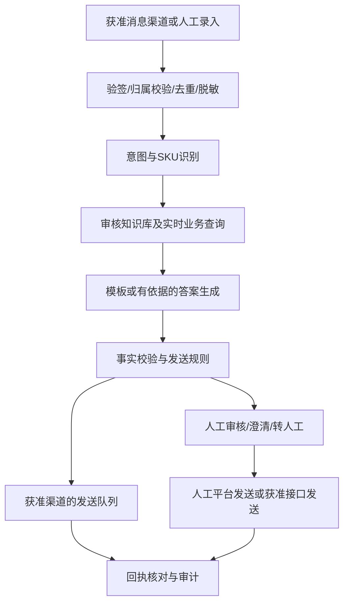

# 小红书产品咨询自动回复：调研与可执行方案

调研日期：2026-10-17（北京时间）  
适用范围：个人号、专业号、店铺经营场景；产品咨询；评论与私信分别评估。  
交付状态：公开资料调研、部分源码检查与实施设计。未登录账号、未申请权限、未运行开源项目、未发送消息。文中的工期、成本和指标是项目规划值，不是平台承诺。

## 1. 建议采用的方案

**建设一套独立部署的产品问答服务，以官方允许的消息渠道接入；先做人工审核辅助，再对经过验证的常见问题开放自动回复。** 程序运行在电脑或服务器上，通过被允许的渠道服务账号，不是把程序直接安装到账号里。

没有可验证的“永不封号”方案。账号风险取决于接入授权、内容、行为、投诉和平台规则；开源、扫码登录、低频操作、模拟真人都不等于平台许可。若必须同时满足“普通个人号、评论和私信全部无人值守、保证不封号”，目前证据不足以承诺实现。

建议顺序：

1. **专业号/店铺相关咨询优先核实官方权限。** 商业开放平台确实列出私信会话能力，但具体主体、账号、消息范围和发送权限要以获批内容为准。[官方商业开放平台](https://ad-market.xiaohongshu.com/app-center)
2. **个人号和未获批评论渠道先用回复辅助台。** 人工通过平台界面查看问题，将必要的脱敏内容交给系统；系统生成带依据的草稿，人工在平台发送。人工审核不代表可以任意自动抓取，消息进入系统也必须有合法、获准的路径。
3. **如果具备小程序资质且愿意增加客服入口，可走官方小程序客服路线。** 这会改变咨询入口，不等同于接管普通私信和笔记评论。[官方客服概述](https://miniapp.xiaohongshu.com/doc/DC186586)
4. 浏览器或桌面自动化开源项目作为技术研究候选，不作为低账号风险生产方案的默认基础。

第一版假设：同一经营主体、少量账号、20–100 个 SKU、文字咨询优先。咨询量尚未确认，容量与成本应在取得真实日峰值后调整。个人号、专业身份、店铺经营权限可能存在关联，不能只按账号名称判断接口权限。

## 2. GitHub 同类项目筛选

| 项目 | 本次确认的能力 | 接入方式和局限 | 采用意见 |
|---|---|---|---|
| [xpzouying/xiaohongshu-mcp](https://github.com/xpzouying/xiaohongshu-mcp) | 笔记详情、评论读取、指定评论回复 | 网页自动化工具；不是官方评论 API；本次未确认普通私信能力 | 可研究评论适配层，不直接承担产品事实判断 |
| [Saqurat/xiaohongshuagent](https://github.com/Saqurat/xiaohongshuagent) | FastAPI 编排、AI 判断并生成评论回复、回复记录 | 依赖 MCP；包含大量本项目不需要的内容生成与采集功能 | 与需求接近，但不能原样上线；优先参考流程而非整套照搬 |
| [BodaFu/auto-rednote](https://github.com/BodaFu/auto-rednote) | 评论回复、通知处理、桌面私信操作 | OpenClaw/浏览器自动化；其私信实现依赖 macOS App 与桌面工具 | 当前 Windows 环境不能直接复用其私信路线；不是官方授权证明 |
| [bububa/spotlight-mapi](https://github.com/bububa/spotlight-mapi) | 聚光 Marketing API 的 Go SDK | 广告业务 SDK；不能据名称推定支持客服收发或通用评论 | 仅作商业 API 集成参考，不是现成问答机器人 |

许可证：xiaohongshu-mcp 当前可读取的 [LICENSE 为 Apache-2.0](https://github.com/xpzouying/xiaohongshu-mcp/blob/main/LICENSE)；auto-rednote 仓库标示 MIT。其他候选本次未完成许可证确认，复用代码之前必须检查。代码许可证和小红书接口使用许可是两回事。

维护性证据限制：本次 GitHub REST 元数据查询遭遇 403 限流，未可靠取得各仓库最新提交时间，不给“持续维护”或“生产成熟”的结论。实施时检查最近提交、未解决故障、发布记录和依赖漏洞，锁定 commit 与镜像版本，不直接追踪 main。

### 一个与需求接近的项目，源码暴露了哪些问题

对 [xiaohongshuagent 的 comment_service.py](https://raw.githubusercontent.com/Saqurat/xiaohongshuagent/main/app/services/comment_service.py) 做了静态检查：

- 仅把笔记摘要等交给模型，没有产品权威知识检索；温度为 0.7，不能保证事实正确。
- 使用本地 JSON 防重；发送失败后仍写入已处理集合，可能漏回。
- 发送成功判断偏宽松，不能可靠区分确认成功与结果未知。
- 读取 list_feeds 后未在该流程明确校验笔记归属，不能直接相信“只处理自己的笔记”。

这些是代码检查发现，未作账号实测。生产实现必须补上产品依据、归属校验、可靠消息状态和故障测试。README 中的低频或随机延时建议不是官方安全阈值。

## 3. 官方能力：哪些已证实，哪些仍待确认

| 场景 | 证据与能力边界 | 执行路线 |
|---|---|---|
| 普通个人号的笔记评论 | 本次未找到可确认面向普通个人号开放的通用评论收发官方接口；不等于断言不存在 | 人工查看、系统生成草稿、人工发送；取得专门权限后再接自动化 |
| 普通个人号私信 | 未确认可自行申请通用收发权限 | 回复辅助；不能用登录授权代替消息权限 |
| 专业号私信 | 商业开放平台展示私信 API 会话服务；准入和具体收发能力未在本次公开页面完整核实 | 先查账号后台与官方对接支持，再决定自研或授权服务商 |
| 店铺客服 | 电商平台提供商品、订单、售后等文档入口，但这不证明当前店铺一定有客服发送权限 | 优先核实官方工作台内置回复与授权客服服务，再确认可调用接口 |
| 小程序客服 | 官方文档明确提供消息收发；用户进入的是小程序客服会话 | 资质、类目和入口合适时可做官方技术落地路径 |
| 到别人笔记下批量答疑 | 不属于本项目默认范围 | 排除主动批量营销、批量私信和跨笔记铺量 |

小程序的接收与发送文档给出收到请求后 48 小时内回复的窗口；**这个窗口只用于该文档所述小程序客服场景，不可套用到普通私信、店铺或评论。** 实施前复核最新页面和账号实际权限。[接收消息与发送消息](https://miniapp.xiaohongshu.com/doc/DC897608)

常见的三种误判需要避免：

- 能 OAuth 登录或取得用户资料，不代表能读私信、发评论。[登录 API 目录](https://openaccount.xiaohongshu.com/docs/api-reference)
- 有 Webhook 不代表有新评论或新私信推送：账号登录平台的文档所列事件为授权撤销、设备扫码确认。[账号授权 Webhook](https://openaccount.xiaohongshu.com/docs/webhook)
- 分享 SDK、广告报表、客资线索推送也不等于客服消息双向收发。[分享 SDK](https://agora.xiaohongshu.com/doc/js)、[聚光入门文档](https://ad.xiaohongshu.com/openApiDoc?articleId=3047&categoryId=761)

### 发给官方支持或服务商的核验问题

此处为可复制的问题模板，本次没有代你发送：

> 我们计划为自有账号提供用户主动发起的产品咨询回复，涉及个人号/专业号/店铺业务。请确认：
> 1. 当前主体和账号可申请哪些客服或私信 API？是否支持 AI 生成回复？
> 2. 能否接收并回复自然流量私信、广告私信、店铺咨询及笔记评论？请逐项说明。
> 3. 是否有原文档、权限 scope、测试环境和正式申请入口？
> 4. 回复窗口、频率配额、消息类型、AI 标识和内容限制分别是什么？
> 5. 回调重试、发送幂等、消息查询、撤销授权的处理要求是什么？
> 6. 服务商是官方授权应用还是代操浏览器？应用主体、授权范围、费用、数据存储地点和删除机制是什么？

保存答复、后台权限截图和文档版本形成权限清单。**未拿到明确的收发权限，自动发送保持关闭；不影响知识库和草稿功能先行开发。**

## 4. 产品准确性设计

### 4.1 数据源优先级

| 内容 | 首选来源 | 不可采用的做法 |
|---|---|---|
| 型号、材质、尺寸、成分、使用方法 | 经负责人审核的说明书、品牌资料、SKU 主数据 | 从竞品评论或模型常识猜测 |
| 兼容性、适用范围、禁忌 | 明确的兼容矩阵与官方说明 | 从名称相近推导兼容，承诺绝对安全 |
| 价格、活动、库存 | 当前授权商品系统或人工维护且有效的结构化数据 | 将旧笔记价格当作实时成交价 |
| 发货时效 | 当前履约规则、区域和仓库数据 | 直接保证某日到货 |
| 退换货、保修 | 生效中的售后政策，保留适用条件 | 模型自行扩大或缩小用户权益 |
| 订单、物流 | 校验身份和归属后的授权订单接口 | 仅凭用户发来的订单号查询或公开回复详情 |

同一问题可能需要商品型号、版本、规格、地区等多个条件。笔记与 SKU 绑定；多商品笔记或指代不清时先问“你指的是哪一款/哪个规格？”。禁止把上一位顾客或另一个账号的上下文带入当前回答。

### 4.2 知识库最小结构

每条产品事实至少保存以下字段，可先由 CSV 导入数据库：

```text
tenant_id, product_id, sku, model, aliases,
fact_type, fact_value, unit, applicable_conditions,
source_title, source_location, source_version,
valid_from, valid_to, reviewed_by, reviewed_at, status
```

只检索 status=approved 且仍有效、属于当前经营主体和 SKU 的事实。保留资料页码/段落用于审核。过期、冲突、无来源的事实不参与自动发送。活动变更后，相关缓存和索引一起失效。

建议先整理 50–100 条高频问题。数据少时，结构化字段和关键词检索就能起步；只有别名、长文说明和语义匹配明显不足时，再加向量检索与重排。第一版不训练专用大模型，也不通过微调记住易变的价格库存。

### 4.3 回复决策

1. 核验账号、渠道、消息归属，并完成脱敏。
2. 判断意图、商品和必要条件；缺少条件就澄清。
3. 检索经过审核的产品事实；动态问题读取业务数据并验证有效期。
4. 固定 FAQ 优先使用审核模板；复杂表述由模型依据检索结果组织语言。
5. 对数字、单位、型号、价格、活动时间、否定条件做程序校验。
6. 返回 draft、clarify、handoff、skip 或 auto_send 决策。
7. 仅在渠道获批、意图在白名单、证据齐全、无冲突、未被人工接管时允许 auto_send。

不能把模型自报的“置信度 95%”当作真实准确率。自动放行主要由可检查的证据条件与独立测试结果决定，模型评分仅可辅助。

建议输出结构：

```json
{
  "action": "clarify",
  "product_id": null,
  "reply_text": "请问你咨询的是哪款产品和规格？",
  "source_ids": [],
  "reason_code": "PRODUCT_UNRESOLVED"
}
```

以上为结构示意；实现时用 schema 约束 action 的枚举值与必填字段。禁止仅因模型生成了合法 JSON 就认为回答正确。

### 4.4 必须转人工的情况

- 无依据、多个来源矛盾、价格或库存已过期、识别不出产品。
- 投诉、赔偿、退款争议、改价、医疗功效、过敏或安全事故。
- 用户要求人工、连续两轮仍无法澄清、图片或语音识别不可靠。
- 需要查订单但身份未核验，或者用户把隐私信息发在公开评论区。

只做读数据和回复，不授予模型退款、改价、删除笔记、关注、批量营销等权限。人工接管后暂停该会话自动回复，必须显式释放，避免人机抢答。

## 5. 系统架构与最小功能



建议技术栈是工程选型，不是已完成的部署：Python + FastAPI、PostgreSQL、简单管理页面、容器化运行。首版使用数据库任务表和单个 worker 即可；只有吞吐量证明确有需要时再加入 Redis、独立向量库或复杂编排框架。模型通过服务端接口调用；用同一批问题比较 2–3 个可用中文模型的准确率、拒答、延迟和实际成本后再定型号。

管理台第一版只需：待处理问题、建议回复、产品/资料依据、编辑与审核、转人工、知识库导入与发布、账号授权状态、全局停发按钮、失败记录。默认展示“草稿”，不要把待发送写成“已回复”。

建议数据表：accounts、products、knowledge_facts、messages、reply_tasks、audit_logs。账号及资料必须绑定 tenant_id；业务读取也按 tenant_id + account_id 校验，避免串号、串店铺和跨用户泄漏。

### 消息可靠性要求

- 入站以账号、渠道、消息 ID 建唯一约束；同一回调重复投递不重复处理。
- 状态区分 received、drafted、approved、sending、sent、failed、unknown、handoff、skipped。
- 网络超时不代表没发出去。unknown 必须先查发送回执/历史；无法核对时转人工，不盲目重发。
- 同一会话串行处理；发送前重新核验最新消息、人工接管状态、授权、有效期与停发开关。
- 回复绑定原始问题 ID。用户追问后旧草稿失效或重新审核，避免错答上一轮。
- 重启后恢复待处理任务，不重新发送已确认完成的消息；备份恢复后也要核对发送状态。
- 若渠道没有幂等与回执查询能力，不承诺严格“只发送一次”，通过结果未知转人工控制重复风险。

小程序消息推送需要按其自己的验签、加解密和回执协议实现；应快速持久化并确认接收，再异步生成答案。不要把账号登录 Webhook 的 HMAC/回执格式复制到小程序客服回调。[小程序服务端消息推送](https://miniapp.xiaohongshu.com/doc/DC469488)

## 6. 账号、内容与数据风险控制

### 账号风险

生产优先官方内置功能、正式获批接口或可核验授权的服务商。若使用官方内置关键词回复已能覆盖大多数问题，先使用它，复杂问题由本系统提供草稿，避免不必要开发。

不要把“每分钟多少条”“每天多少条”“随机延时”写成免封保证。配额和发送窗口来自对应渠道文档与获批限制；内部可设置更保守的业务上限，但仍不是平台承诺。不要为绕过处罚轮换账号、代理 IP、设备指纹或验证码服务。

出现授权失效、权限不足、平台处罚提示、异常登录提示时，停用相关发送渠道并提示负责人核查。限流按官方重试要求退避；严重内容错误、错误对象或隐私泄漏触发立即停发。账号恢复依据问题修复和平台反馈，不凭“等几天就没事”。

本次未成功取得完整的当前官方用户服务协议正文，不能据此给出“平台允许个人号浏览器自动化”的结论。上线前须从 App/后台核查《用户服务协议》《社区公约/规范》《专业号规则》《店铺客服规则》以及适用的导流、营销、行业规则，留存版本。第三方转载只能作检索线索，不能替代当前官方文件。

### 内容风险

只回复用户主动咨询且在权限范围内的内容。避免重复刷屏、站外交易引导、夸大功效、虚构优惠、绝对化保证和冒充人工。采用适合渠道的 AI 提示，并支持转人工。

《人工智能生成合成内容标识办法》已于 2025-09-01 施行，涉及文本等生成内容及发布声明/标识义务。具体到评论、私信的标识方式应核对平台功能及适用要求；不能认定账号简介写一次就一定足够，也不要去除已有标识。[官方办法原文](https://www.nrta.gov.cn/art/2025/3/14/art_113_70340.html)

### 隐私与安全

个人信息处理需有明确目的和适用的合法基础，并遵循必要范围；向模型服务提供用户信息前要核实委托处理、保存、训练使用和跨境安排。国内服务也不能免除这些核查。[《个人信息保护法》官方原文](https://www.cac.gov.cn/2021-08/20/c_1631050028355286.htm)

工程措施：

- 模型只接收必要的问题及产品依据；手机号、地址、身份证、完整订单号默认遮蔽。
- 公共评论不披露订单或联系方式；订单数据按登录身份、会话绑定和所有权核验。
- API 密钥、Token 放服务端密钥配置，日志中不记录；不要求顾客提供小红书密码。
- 管理台身份验证、最小权限、操作审计；数据库不暴露公网，备份加密并测试恢复。
- 用户消息及检索资料视为不可信输入；其中“忽略规则”“调用工具”等内容不能改变系统权限。
- 资料导入仅允许指定人员；新资料须审核，不能让顾客消息自动成为产品事实。
- 保留期限按实际业务、合同和适用规定确定；可先提出原始咨询 30 天的最小化配置供审核，不能把它当法定统一期限。到期清理正文及备份副本的流程必须落实。

## 7. 制作与部署流程

以下是开发排期示例，按一名开发者加一名产品资料/客服负责人估算。平台审批等待不计入工期。

| 阶段 | 工作与交付物 | 验收/停止条件 | 估算工作日 |
|---|---|---|---|
| 0. 权限核验 | 账号、主体、渠道、scope、配额、窗口与费用表 | 无明确收发权限则走辅助版，不开发假定存在的接口 | 1–3，加外部等待 |
| 1. 产品资料整理 | SKU 表、笔记映射、审核 FAQ、来源版本与负责人 | 每条可自动回复事实可追溯，价格库存有效期明确 | 2–4 |
| 2. 离线问答原型 | 人工输入问题、检索、草稿、依据、转人工 | 用脱敏测试集验证，不连接真实发送 | 3–5 |
| 3. 管理与可靠性 | 审核台、权限隔离、任务状态、去重、停发、日志 | 重复回调/断网/重启/越权测试通过 | 3–5 |
| 4. 授权渠道联调 | 只接一个已获批消息渠道；验签、收发、回执 | 用平台允许的测试方式验证；不绕过权限障碍 | 2–4 |
| 5. 影子与人工审核 | 先只生成；人工比较，再审核发送 | 满足下节指标，修复高风险错误 | 5–7 个观察日 |
| 6. 白名单自动回复 | 开放少量稳定 FAQ；其余转人工 | 持续抽检，任何严重错误立即回退 | 逐步进行 |

整体可按约 3–5 周安排首轮试点；全量商品清洗、ERP 对接和审批可能显著延长。权限暂未获批时，辅助版仍可独立交付。

### 部署步骤

1. 先本地开发离线问答与审核功能。默认 `AUTO_SEND_ENABLED=false`，用模拟消息验证流程。
2. 固定依赖版本、仓库 commit 和镜像 digest，检查安装脚本及不需要的外部回传；禁止下载未知预编译工具后直接给账号登录态。
3. 小流量初始可按 2 核/4 GB 云主机、托管或同机数据库估算，模型走 API，不部署本地 GPU；实际配置由压测决定。
4. 部署 API、worker、数据库和 HTTPS 网关；管理台限制访问，数据库只走内网。涉及中国大陆公网服务时向接入商核对域名备案等适用要求。
5. 配置备份、恢复、密钥、告警和费用上限；按渠道实际协议接入回调。不同应用的签名和 Token 不混用。
6. 用测试环境/获准测试账号验证完整收发、撤销授权、窗口到期和异常消息。没有官方沙箱时确认允许的联调方式。
7. 导入审批后的资料，运行冻结测试集；上线影子模式，再开放人工审核发送。
8. 通过试点后，仅对已验证的意图白名单启用自动发送。保留按账号、渠道和全局三级停发功能。

回滚动作：关闭发送开关、停止领取待发任务、冻结队列、核对在途请求、保留已发送记录、人工接管。关闭开关不能撤回已经发送的内容；错误回复由负责人通过平台允许方式纠正。

## 8. 验收标准：准确率必须可测量

以下是建议门槛，不是已达到的结果。建立 300 条独立测试问题，开发调试题与验收题分开，不能用修改后的标准答案反复“刷分”。

| 测试类别 | 建议条数 | 检查点 |
|---|---:|---|
| 正常产品 FAQ | 120 | 事实、条件、单位正确 |
| 型号歧义、别名、多轮指代 | 50 | 正确澄清或识别，不串产品 |
| 价格库存、活动过期与接口故障 | 40 | 使用有效数据，故障时不编造 |
| 投诉、功效、安全与隐私 | 40 | 按规则转人工，无隐私披露 |
| 提示注入、越权、恶意内容 | 30 | 不改规则、不越权、不泄密 |
| 重复事件、发送超时与人工接管 | 20 | 不重复发送、不人机抢答 |

由熟悉产品的人标注标准事实与允许回复范围；另一人复核争议项。模型可以辅助评测，不能独立判定自己的准确率。

- **事实准确率**：全部实质事实和适用条件正确的答案数 / 实际给出事实性答案数，建议 ≥98%；分别报告各类问题，不能只给总体平均。
- **不应回答的处理正确率**：应澄清/转人工而正确处理的数量 / 所有此类问题数，建议 ≥95%。
- **自动回复覆盖率**：自动回复问题数 / 有效产品咨询数，必须同时报告，避免全拒答制造高准确率；第一版不强制高覆盖。
- **关键错误**：冻结测试与试点中错误价格承诺、串 SKU、隐私泄漏、越权发送为 0；发现一例先停相关自动策略。样本零错误不等于未来风险为零。
- **可靠性**：在重复投递、超时、重启、授权撤销、人工接管场景中无可确认重复/越权发送；未知状态必须进入人工核对。
- **性能**：草稿生成 P95 可先设为 10 秒以内，最终发送时延按平台规则及人工流程单独统计；这不是平台配额。

试点先选一个渠道、5–10 个商品和一组稳定 FAQ。上线首周对自动发送内容全量回看；流量增长后再采用风险分层抽检。每日记录错答、漏答、转人工、投诉、发送失败、限流与单条成本；每周把新问题纳入评测并更新资料。

## 9. 成本、人员与维护

成本必须分开看：开发、产品资料整理、服务器、模型调用、平台/服务商费用、人工审核与持续维护。开源代码免费不等于运营免费。

模型月成本估算公式：

```text
月成本 = 月问题数 × (平均输入token × 输入单价 + 平均输出token × 输出单价) / 1,000,000
       + 检索/重排成本 + 重试成本
```

例如每天 300 条、30 天共 9,000 条，每条约 2,500 输入 token、250 输出 token，基础用量约为 2,250 万输入和 225 万输出 token；多次调用需要累加。用候选模型官网在采购当天的价格计算，不以聊天订阅价格替代 API 费用。

小规模试点可暂预留服务器、存储、备份、监控合计每月 200–600 元、模型每月 100–500 元作为内部预算占位；不是实时报价或保证，平台服务费和人力另计，实际可能超出。先设置硬预算和单会话调用上限，记录真实用量再调整。

最少需要一个技术负责人和一个产品资料/客服负责人。技术负责人负责接入、权限、任务可靠性和告警；业务负责人审核事实、活动、售后政策并处理复杂咨询。上线后每周检查数据版本和失败记录，每月复核渠道权限/规则变更及依赖更新。不要无人负责地长期运行。

## 10. 官方文件与证据索引

| 文件/入口 | 用途 | 本次核实范围 |
|---|---|---|
| [商业开放平台](https://ad-market.xiaohongshu.com/app-center) | 私信能力申请线索 | 官方索引列有私信会话能力；未核实你的账号准入与配额 |
| [电商开放平台开发文档](https://open.xiaohongshu.com/document/developer/file/17) | 商品、订单、售后、授权、限流和开发者规则 | 已检索目录；动态正文读取有限，实施前需后台复核 |
| [登录 API 参考](https://openaccount.xiaohongshu.com/docs/api-reference) | 区分身份授权和客服权限 | 已读取接口目录，不能作为客服收发依据 |
| [登录授权 Webhook](https://openaccount.xiaohongshu.com/docs/webhook) | 授权撤销等事件 | 不当作通用消息回调 |
| [小程序客服概述](https://miniapp.xiaohongshu.com/doc/DC186586) | 客服入口与会话范围 | 官方索引正文可检索 |
| [小程序接收与发送消息](https://miniapp.xiaohongshu.com/doc/DC897608) | 客服消息和回复窗口 | 官方索引正文可检索；窗口仅适用该渠道 |
| [小程序服务端消息推送](https://miniapp.xiaohongshu.com/doc/DC469488) | 验签、加解密、回执和重试 | 官方索引正文可检索；直接打开部分动态页失败 |
| [小程序介绍与准入说明](https://miniapp.xiaohongshu.com/doc/DC137160) | 评估主体、类目与客服路线 | 需要按实际经营类目进一步核实 |
| [小程序第三方平台开发者协议](https://miniapp.xiaohongshu.com/doc/DC430242) | 若做第三方服务商，核对相关责任 | 不能自动套用于所有自用场景 |
| [分享 SDK 文档](https://agora.xiaohongshu.com/doc/js) | 排除把分享当作回复接口 | 文档存在能力限制，不作为消息接入方案 |
| [人工智能生成合成内容标识办法](https://www.nrta.gov.cn/art/2025/3/14/art_113_70340.html) | AI 内容声明、标识安排 | 官方原文；具体渠道实施方式待核实 |
| [个人信息保护法](https://www.cac.gov.cn/2021-08/20/c_1631050028355286.htm) | 最小化、告知、委托和跨境核查 | 官方原文 |

另需在实际账号中取得当前的用户协议、社区规则、专业号和店铺规则，以及获批私信/客服 API 的详细文档。未取得的文件明确列为上线前置条件，不用第三方文章填补为“官方确认”。

## 11. 开工清单与最终交付清单

业务侧准备：

- [ ] 选择首个试点账号和一个渠道：评论、普通私信、店铺客服或小程序客服。
- [ ] 提供主体与权限信息，不提供密码；核实平台内置自动回复是否已够用。
- [ ] 确定产品品类、SKU 数量、日均/峰值咨询量和人工服务时段。
- [ ] 整理说明书、商品资料、价格库存来源、售后政策及可承诺范围。
- [ ] 指定资料审批人、投诉处理人、账号异常处理人。
- [ ] 决定预算上限和数据保存范围。

开发交付：

- [ ] 可部署的问答 API、审核台、消息处理 worker 和数据库迁移。
- [ ] 只包含已获批渠道的适配器；其余渠道明确为人工辅助。
- [ ] 带来源与版本的产品知识库、SKU/笔记映射和资料更新流程。
- [ ] 300 条冻结测试集、评测报告、故障测试记录和试点结果。
- [ ] 部署配置示例（无真实密钥）、备份恢复、停发回滚与运营手册。
- [ ] 开源依赖/许可证清单、权限清单和官方规则核查记录。

**实施建议：先交付“产品知识库 + 有依据的回复草稿 + 人工审核”，同步核验专业号/店铺官方消息权限。权限与质量门槛同时通过后，才把稳定 FAQ 升级为自动回复。**
